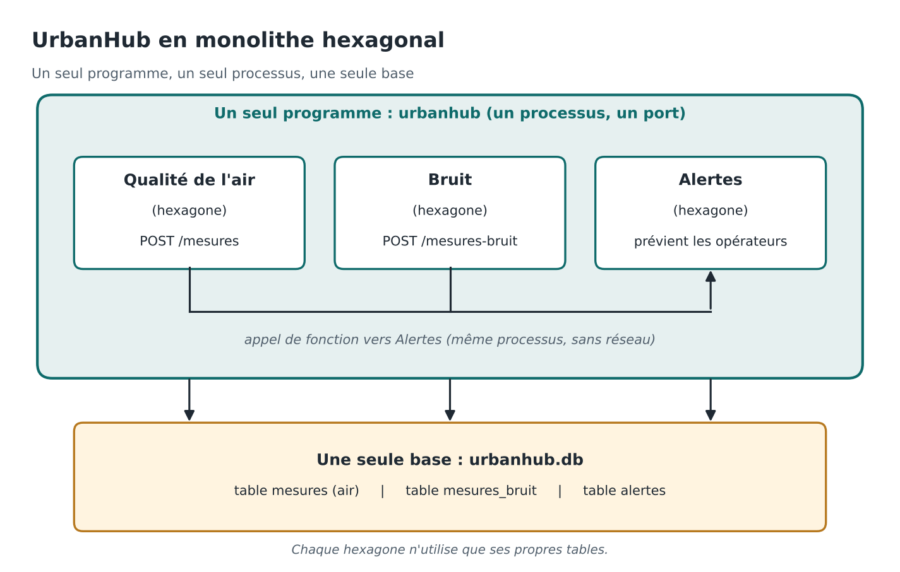
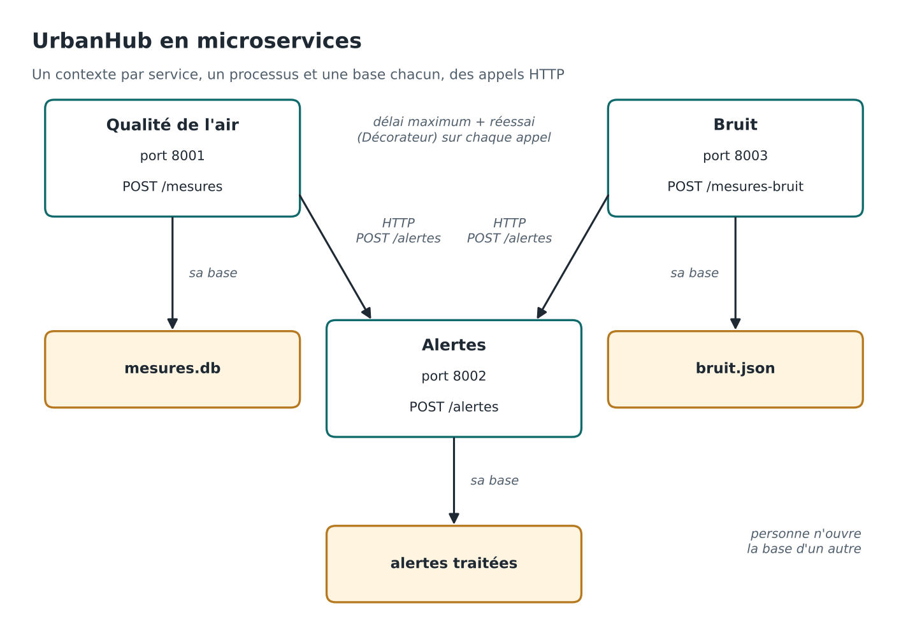

# TP 3 — Étape 2 : UrbanHub en monolithe, puis en microservices

Les trois contextes de l'étape 1 (Qualité de l'air, Bruit, Alertes) sont déjà écrits en hexagone. Je les assemble de deux façons.

## Schéma 1 : le monolithe hexagonal

Un seul programme, un seul processus, une seule base. Les trois hexagones restent séparés à l'intérieur.

- Qualité de l'air et Bruit préviennent Alertes par un **appel de fonction**, sans réseau.
- Chaque hexagone garde **ses propres tables** : aucun ne lit la table d'un autre.
- Grâce à l'hexagone, passer de l'appel de fonction à HTTP, c'est seulement changer l'adaptateur du port qui publie les alertes.

## Schéma 2 : les microservices

Un contexte par service, chacun dans son processus, avec sa base à lui. Ils se parlent par HTTP.

- **3 processus**, qui démarrent et se livrent séparément.
- **3 bases** : personne n'ouvre la base d'un autre.
- Qualité de l'air et Bruit envoient leurs alertes à Alertes par **HTTP**, avec un délai maximum et un réessai (le Décorateur).

## Ce qui change entre les deux

| | Monolithe | Microservices |
|---|---|---|
| Programmes | 1 | 3 |
| Bases | 1 (une table par contexte) | 3 (une base par service) |
| Pour prévenir Alertes | un appel de fonction | un appel HTTP |
| Le code métier (les hexagones) | le même | le même |