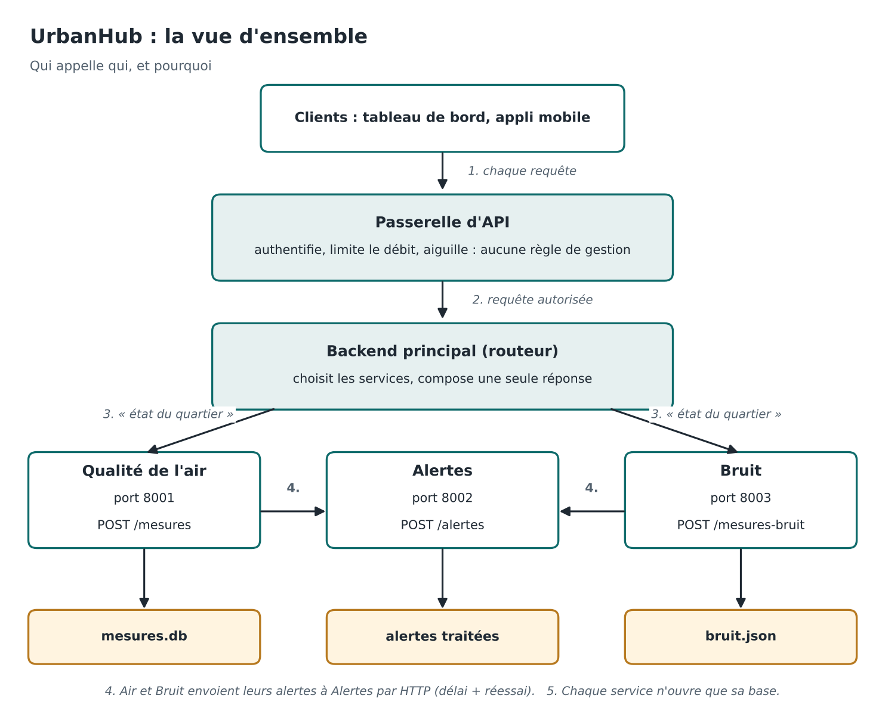

# TP 3 — Étape 4 : la vue d'ensemble

## Qui appelle qui, et pourquoi

| Qui | Appelle | Pourquoi |
|---|---|---|
| Les clients (tableau de bord, appli mobile) | La passerelle d'API | C'est le seul point d'entrée : aucun client n'appelle un service directement. |
| La passerelle d'API | Le backend principal | Après avoir authentifié le client et limité son débit. Elle n'a aucune règle de gestion. |
| Le backend principal | Qualité de l'air et Bruit | Pour composer une seule réponse, par exemple « l'état du quartier ». |
| Qualité de l'air et Bruit | Alertes (`POST /alertes`) | Pour prévenir les opérateurs quand un seuil est dépassé, avec un délai maximum et un réessai. |
| Chaque service | Sa propre base | Personne n'ouvre la base d'un autre. |

La passerelle et le backend principal ne sont pas encore codés : je les propose pour la version en microservices. Les trois services existent déjà.

## La gestion de chaque service

### Configuration par environnement

La configuration vient des variables d'environnement, jamais du code. Elle est lue dans `principal.ts`.

| Service | Variables | En développement | En production |
|---|---|---|---|
| Qualité de l'air | `PORT`, `BASE_MESURES`, `URL_ALERTES` | `8001`, `mesures.db`, `http://localhost:8002/alertes` | `8001`, `/donnees/mesures.db`, `http://alertes:8002/alertes` |
| Bruit | `PORT`, `BASE_BRUIT`, `URL_ALERTES` | `8003`, `bruit.json`, `http://localhost:8002/alertes` | `8003`, `/donnees/bruit.json`, `http://alertes:8002/alertes` |
| Alertes | `PORT` | `8002` | `8002` |

En production, `/donnees` est un volume : les données survivent au remplacement du conteneur.

### Supervision

| Service | Journaux | Métriques à suivre | Traces |
|---|---|---|---|
| Qualité de l'air | Les erreurs sont écrites dans la console | Mesures reçues par seconde, erreurs 422 et 500, temps de réponse | Le trajet d'une mesure jusqu'à Alertes |
| Bruit | « Service Bruit prêt » au démarrage, et les erreurs | Mesures reçues par seconde, erreurs 422 et 500, temps de réponse | Le trajet d'une mesure jusqu'à Alertes |
| Alertes | Chaque alerte reçue, et chaque alerte envoyée aux opérateurs | Alertes reçues, doublons écartés | L'alerte reçue, avec le service qui l'a envoyée |

L'identifiant de l'alerte (par exemple `bruit-3:bruit:2026-11-18T23`) voyage d'un service à l'autre : il sert d'identifiant de corrélation pour retrouver une alerte dans les journaux des deux services.

### Livraison

Chaque service a sa propre image Docker, qui ne contient que son code (comme le Dockerfile de Qualité de l'air dans le cours). Il se livre seul :

1. `npm test` doit passer ;
2. on construit l'image du service ;
3. on la met en ligne avec la stratégie choisie à l'étape 5.

Je peux livrer Bruit sans toucher à Qualité de l'air ni à Alertes.